### 一些概念
`Reliable bidirectional byte stream` 可靠双向字节流  
数据可以双向传输（全双工），双方也均可随时断开连接

`HTTP`即`hypertext transfer proctocol`  
以文档为中心；客户端连接服务器，发送请求，服务器读取请求并响应

`BitTorrent`  
客户端间互相请求；协作的客户端集合被称作'swarm'  

`NAT`‌网络地址转换  
使多台内网设备共享少量公网 IP 访问互联网  

`‌Rendezvous Server`会合服务器  
在P2P网络里帮两端设备建立连接的协调服务器  
>（因为客户端使用NAT时外部难以直接连接，所以需要借助会合服务器：  
原本是B->A（不可行）   
于是B->会合服务器  
（建立了TCP（双向）连接之后NAT会维护通信）  
会合服务器->A
再A->B
）  
若B也在NAT后  
则需尝试`NAT Hole Punching`或使用`Relay Server`
___________________
## 四层互联网模型：  Application -> Transport -> Network -> Link
互联网的一个核心设计思想：逐跳转发`Hop-by-Hop Forwarding`  
>转发发生在链路层  

Datagram（数据报）并不是一开始就知道从源主机到目的主机的完整路径，然后沿着这条固定路径传输；相反，它通常由沿途的每一台路由器独立决定下一步应该送往哪里，直到最终抵达目的地。

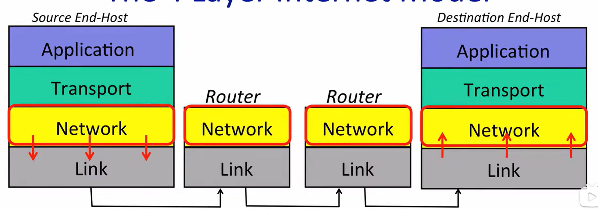
> 网络层与链路层职责分离  
>如：网络层负责封装与解封装`IP Datagram`，而链路层则封装与解封装帧（如以太网帧、或通过wifi等）

每一台路由器都会使用路由表`Routing Table`（更准确地说，转发时会查询由路由信息构建的转发表`Forwarding Table`）。

>假设网络如下：
>
>我们一步步来看。
>
>第一步：A 向 R1 发送数据报
>
>A 判断目的 IP 不在本地网络，因此将 Datagram 发给默认网关 R1。
>
>第二步：R1 决定下一跳
>
>R1 收到数据报后，检查目的 IP，并查询自己的转发表：
>
>| 目的网络              | 下一跳  |
>| ----------------- | ---- |
>| `203.0.113.0/24`  | R2   |
>| `198.51.100.0/24` | R3   |
>| 其他网络              | 默认路由 |
>
>由于目的地址是 `203.0.113.80`，R1 决定把数据报交给 R2。
>
>第三步：R2 再次作出转发决定
>
>R2 收到数据报后，独立查询自己的转发表，判断应该从哪个接口将数据报发送出去。
>
>如果 B 位于 R2 直连的网络上，R2 就可以直接向 B 交付数据报。  
>……

### 全局目的地址+局部下一跳决策=逐跳转发

每个 Datagram 携带最终目的 IP 地址，但路由器通常只需要根据本地转发表决定下一跳。 多个路由器的局部决策组合起来，就实现了从源主机到目的主机的端到端传输。
___________

传输控制协议`Transmission Control Protocol`（即TCP） 
>TCP位于传输层

用于在互联网中实现可靠的数据传输（因为IP数据报可能丢失、损坏、乱序）  
`TCP/IP`也就是同时使用TCP与IP协议  
TCP将在必要时多次重传、对数据重新排序等

用户数据报协议`User Datagram Protocol`（即UDP）
>UDP位于传输层

UDP不提供任何交付保证（一些服务不需要确保传输完全可靠无误）
____
应用层包含HTTP等协议（网络应用）。  
应用层无需关心数据如何传输。  
应用层发送数据时，将会把数据交给传输层，由后者可靠或不可靠地传送达另一端；传输层将数据交给网络层，从而发往另一端；网络层将数据拆分为带有正确目的地址的数据包；最后数据包交给链路层，其负责沿路径逐跳交付。

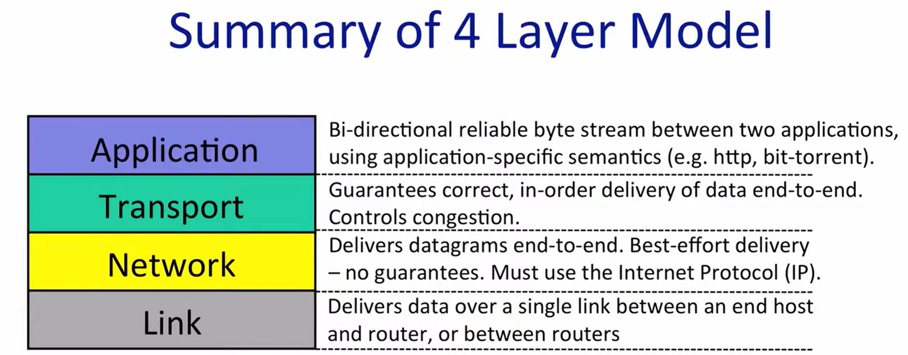

IP is the 'thin waist'.  
在网络层除了IP协议没有别的选择。

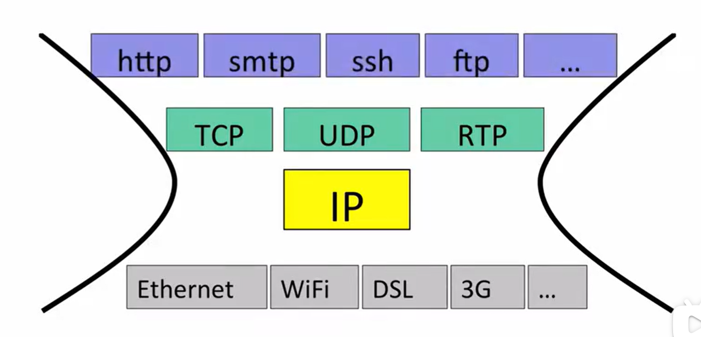
______
## The IP Service IP服务模型
IP数据报的组成：IP Header + IP Data

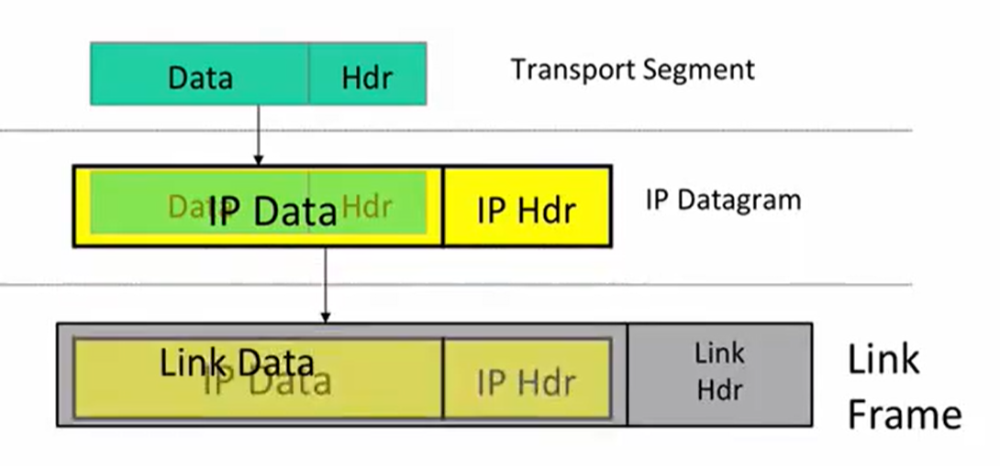

传输层：Transport Segment（传输段）  
网络层：IP Datagram（IP数据报）  
链路层：Link Frame（链路帧）  

### IP服务模型的四个特点：
1. 数据报被独立地打包，逐跳路由（IP Header将含有IPSA和IPDA）  
2. __不可靠__。可能迟到、乱序、重复，不承诺错误不发生，也不负责在错误发生时进行检测。没有保证
3. __尽力__。只在必要时丢弃数据报，如路由器因拥塞导致队列满员，数据报被迫丢弃到下一个分组
4. __无连接的__（connectionless）。通信双方在发送数据前不需要预先建立连接

### 为什么IP服务如此简单：  
1. 简单，于是更加迅速、成本低、易于维护
2. 端到端原则。只要端点能够正确实现功能，就应该尽量在端点实现  
3. 允许各种可靠或不可靠的服务建立在其之上
4. 可以在任何链路层上运行，对下层链路几乎没有假设

### IP服务的5个特性（简略）：
1. 防止死循环，避免数据报沿路径一直绕圈（IP在每个数据报头部添加了一个跳数计数字段，称为生存时间`TTL`，如初始为128，每跳-1）
2. 在数据报过长时会拆分数据报，同时保留端主机重组数据所需要的信息
3. 在数据报头部使用校验和数据段`ckecksum field`
4. 为新版的IP留有空间
5. 允许在数据报头部添加新的字段
### IPv4的头部结构：
最重要的三个字段：__目的IP地址、源IP地址和协议ID__（如ID为6则可交给TCP代码解析）  
__版本字段__：指明所使用的IP版本，合法值为IPv4和IPv6  
__总字段长度Total Packet Length__：最大能到64KB，包括头部和所有数据  
__TTL__：Time to Live  
__分组标识、标志位、片偏移__：帮助路由器把IP分组拆成更小的独立数据报  
__服务类型字段__：告诉路由器该分组的重要程度  
__头部长度__：指明头部占用多少字节  
__其他可选字段__
_____
## TCP三次握手协议
绝大多数web流量都走TCP。  
典型情况下，存在一个客户端和一个服务器
1. 握手的第一步：客户端发送同步消息（synchronize，`SYN`）
2. 第二步：服务器回应同步并确认消息（synchronize and acknowledge，`SYN/ACK`）
3. 第三步：客户端确认服务器的同步（acknowledge，`ACK`）  

要建立TCP连接，需要两个地址：IP地址和TCP端口

可以通过应用Wireshark分析网络协议

`tracert`命令可以探测本机到目标IP地址之间，数据包经过的路由节点以及各节点的往返时间。
```powershell
tracert www.bilibili.com
tracert -d www.bilibili.com #快速追踪，不进行反向 DNS 查询
tracert -w 1000 www.bilibili.com #设置超时等待时间
tracert -d -h 5 www.bilibili.com #限制最大跳数
```
________
## 分组交换原理（PS, Packet Switching）
__分组Packet__：携带抵达目的地所需信息的独立（self-contained）数据单元  
分组交换的理念是将数据拆分为离散的独立的数据块，每个称为分组的块携带足够信息，使网络能将其送达目的地。  
__分组交换的原理__：对于每一个到达的分组都独立地选择一条输出链路，链路空闲则发送，否则就先缓存起来稍后再发  

一个例子：每个分组包含显式的路由信息，指定沿途各个分组交换机的ID直至目的地（被称为自路由/源路由）
>_互联网支持源路由但通常默认关闭，因为存在重大的安全隐患_

当今的主流做法：在每个交换机中保存少量状态指示分组的下一条（路由选择表）  
于是分组只需要携带目的地址，由沿途交换机做出判断

### 分组交换的两个优势：
1. 交换机为每个分组独立做出局部决策。交换机只需要转发分组，极大地简化了交换机的设计  
2. 高效地在多方之间共享链路

__流Flow__：属于同一个端到端通信中一组数据报的集合（如TCP连接）   
交换机无需知晓每个分组属于的流，也不需要管理流的状态  

__数据流量具有突发性__，并不是所有用户都会在同一时刻持续占用最大带宽。基于此，分组交换不预先为每条通信分配固定的带宽，而是让不同通信产生的分组动态共享同一条链路（体现Statistical Multiplexing统计复用）
_________
## 分层原则

每一层只与直接相邻的上一层与下一层交互，每一层都为上层提供明确的服务，同时利用下层的服务和自身的私有处理来运作。

### 分层的优势：
1. 模块化
2. 服务定义清晰
3. 可复用性好
4. 关注点分离
5. 允许对每个功能进行持续的改进
6. _（专门针对分层通信系统）_ 对等通信
_____
## 封装原则（Principle: Encapsulation）
封装是分层与分组交换相结合的产物。我们需要将数据拆分为独立的分组，但每个分组内部包含多层数据（如TCP段被封装在IP分组中，而IP分组被封装在以太网帧中）
______
## 字节序
计算机需要约定消息的字段、排列格式和编码方式
### 电脑内存模型
现在的电脑内存按字节组织，每8位为一个字节。程序的地址空间从0开始。  
电脑最大能寻址2的64次方字节
> __大端字节序和小端字节序__  
>大端序和小端序是多字节数据在内存中按字节排列的顺序。它们只涉及“字节顺序”，不涉及一个字节内部的位顺序。  
>__大端序 Big-Endian__：最高有效字节放在最低地址  
>__小端序 Little-Endian__：最低有效字节放在最低地址
>```c
>uint32_t x = 0x12345678;
>由四个字节组成：
>0x12  0x34  0x56  0x78
>高字节            低字节
> MSB               LSB
>
>大端序：
>0x1000	0x12
>0x1001	0x34
>0x1002	0x56
>0x1003	0x78
>// 更符合从左到右的阅读习惯
>小端序：
>0x1000	0x78
>0x1001	0x56
>0x1002	0x34
>0x1003	0x12
>// 从计算架构的角度看更加合理
>```
_*所有互联网协议规范都采用大端格式_

测试平台采用的字节序的方法：
```cpp
#include<cstdint>
#include<cstdio>
using namespace std;
int main(){
    uint16_t a=0x0400;
    uint8_t* p=(uint8_t*)&a;
    // 注意!!这里定义指针时，指针类型将会决定解引用读取多少字节
    if(p[0]==0x04){
        printf("big endian\n");
    }
    else if(p[1]==0x04){
        printf("little endian\n");
    }
    return 0;
}
```
转换网络包的字节序与主机的字节序：  
linux/unix中可用`<arpa/inet.h>`库中的`htons()`等  
而在windows则用`<winsock2.h>`库中的同名函数：
```cpp
#include <winsock2.h>
#include <iostream>
using namespace std;
int main(){
    unsigned short port = 8080;    // 端口
    unsigned long value = 0x12345678;    // 数值

    auto network_port = htons(port);
    // "host to network short(16)"
    auto network_value = htonl(value);
    // "host to network long(32)"

    std::cout << "Host port: " << port << '\n';
    std::cout << "Network port: " << network_port << '\n';

    std::cout << "Restored port: "
              << ntohs(network_port) << '\n';
            // "network to host short"

    std::cout << std::hex;
    std::cout << "Restored value: "
              << ntohl(network_value) << '\n';
            // "network to host long"
    return 0;
}
```
__注意不要忘记转换或者重复转换！！！__

### 包格式Packet Formats：
协议规范使用纯ASCII文本编写。
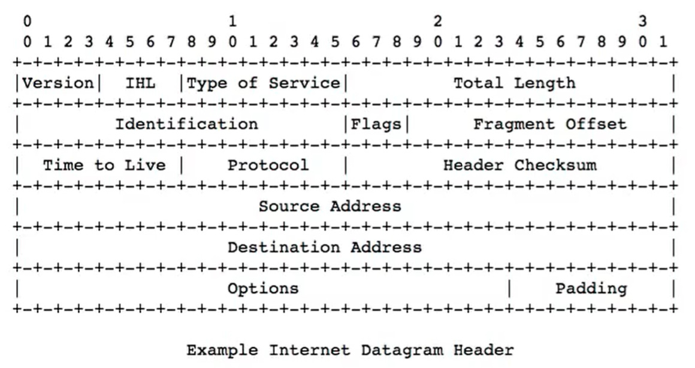
>IPv4规范：  
>按四字节宽度书写，有五行必填字段（前五行）  
>总长度字段为2字节，意味着IPv4数据报的总长度不能超过65535字节

<span style="color:lightyellow"> _一个具体的例子_ </span>
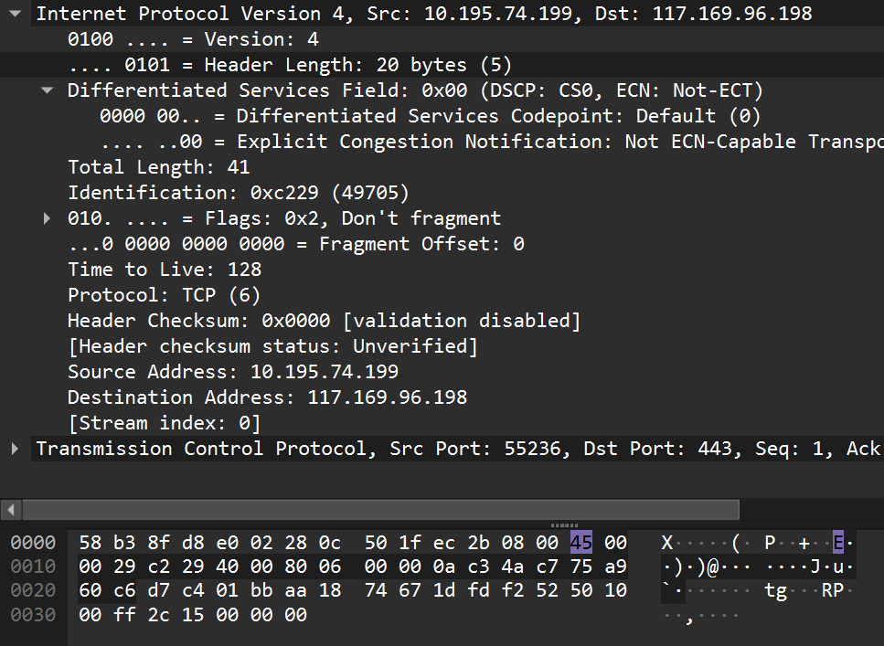
______

## IPv4协议
IP：Internet Protocol，互联网协议  
一个典型的IPv4地址：  
长32位，通常写成四个八位数值a.b.c.d  
子网掩码`Net Mask`：
用来指明哪些IP地址属于本地同一链路网络，哪些需要经由IP路由器转发  
把子网掩码与IP地址作按位与运算，就能判断是否在同一网段  
>e.g.  
>255.255.255.0意味着前24位需要一致  
>255.128.0.0意味着前9位需要一致  
>通常越小的子网掩码意味着越大的网络

### IPv4地址是如何组织的：
__无类别域间路由，Classless Inter Domain Routing，CIDR__：一种更灵活的IP地址分配和路由方法，用来取代传统的A/B/C类固定划分方式  
其允许前缀长度为任意位数，网络块的大小由前缀长度决定  
>_前缀长度越长，所表示的地址集合越小；前缀长度越短，所表示的地址集合越大。_

表示CIDR地址的方法“斜线记法”‌：格式是“网络地址/前缀长度”（如192.168.1.0/24表示前24位是网络部分，后8位是主机部分）  

IPv4地址由IANA机构负责分配管理。
_____
## 最长前缀匹配（Longest Prefix Match）
互联网路由器拥有多条链路，因此对接收到的数据包有多种转发方向可选。为了确定数据包的转发路径，现代路由器通常使用一种叫做最长前缀匹配的算法。

路由器依靠转发表决定将数据包发往哪条链路。路由器会比对转发表找到最匹配（即最具体）的项然后沿对应链路转发。  
默认路由相当于全通配，会匹配所有的IP。如果没有比默认路由更具体的匹配项，路由器将会直接使用默认路由。  
每个路由器都会维护一张转发表，表项包含描述地址块的CIDR条目和对应的下一跳。
_____
## 地址解析协议（Address Resolution Protocol，ARP）
ARP协议是一种将IP地址解析为对应链路层地址的网络协议。  
其意在解决这样一个看似简单的问题：
>已经知道下一跳设备的 IP 地址，如何知道应该将以太网帧发送到哪个 MAC 地址

IP Datagram 并不能直接作为以太网帧在以太网上发送  
它必须被封装成 Ethernet Frame  
因此必须获知对方的MAC地址

>- IP 地址用于网络层寻址，帮助数据报跨网络到达目的地。
>- MAC 地址用于以太网等链路层技术中的帧寻址，帮助帧在当前二层网络（即链路层网络）中交付。

_ARP 不负责计算路由，也 __不负责跨越整个互联网寻找某台主机的 MAC 地址__ 。  
它 __只处理当前链路上需要解析的下一跳地址__ 。_

### 基于以太网的ARP具体实现：
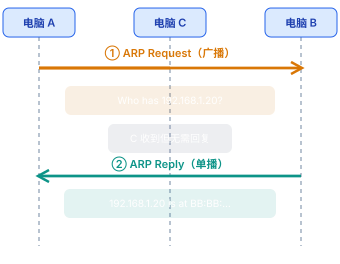
ARP请求发送的方式：使用链路层广播地址`FF:FF:FF:FF:FF:FF`  
直接利用以太网的广播能力，让当前广播域中的设备都有机会看到请求
>ARP 是通过链路层帧直接承载的协议，并不需要通过 IP Datagram 传输  
>它为 IP 网络层提供地址解析服务，但其报文本身直接封装在以太网等链路层帧中

ARP Request 的广播范围由 __链路层广播域（Broadcast Domain）__ 决定  
当一台主机发送目的 MAC 为`FF:FF:FF:FF:FF:FF`的以太网帧时，交换机通常会将该帧转发到同一 VLAN 中除入端口之外的其他相关端口

由于在普通 IPv4 以太网中，下一跳应当是能够通过所选择的出接口进行链路层交付的地址（On-link，在链路上可达），下一跳通常确实应该与发送方处于同一个可进行二层交付的网络中  
因此ARP 广播通常能被下一跳监听并回复  
>_然而链路故障、网络隔离、地址配置错误等原因都可能导致解析失败_

可以把整个关系概括成
$$
\boxed{
\begin{aligned}
&\text{Routing / LPM：决定下一跳 IP}\\
&\downarrow\\
&\text{ARP：解析下一跳的 MAC}\\
&\downarrow\\
&\text{Ethernet：在当前广播域内交付帧}
\end{aligned}
}
$$

### ARP缓存（ARP Cache）
如果每发送一个 IP 数据报就广播一次 ARP Request，那么网络开销会非常大。因此，操作系统通常会维护 ARP Cache

当系统准备发送数据时：
```txt
先查询邻居缓存
        |
        +-- 存在可用映射 → 直接构造帧
        |
        +-- 不存在映射 → 发起 ARP 解析
                              |
                              +-- 成功 → 更新缓存并发送
                              |
                              +-- 失败 → 无法完成本次链路交付
```

>ARP缓存会在一定时间后过期

### ARP数据包的真实结构：
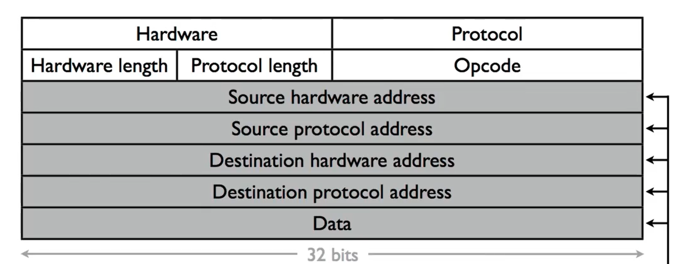
ARP数据包包含10个字段：

- 硬件字段：指明该请求或响应所属的链路层类型 
- 协议字段：指明该请求或响应所属的网络协议类型
- 长度字段指明了链路层和网络层地址的长度（单位为字节） 
- 操作码：指明该包是请求还是响应（`1`为request，`2`为reply）
- 四个地址字段：用于请求和指定映射（长度可变，按大端序存储）
> 如Destination Hardware Address为`00:00:00:00:00:00`时则表示请求解析目标IP地址  
><span style="color:lightyellow">这里的Destination Hardware Address（位于ARP报文中）与表示广播的`FF:FF:FF:FF:FF:FF`（位于以太网帧头中）意义不同</span>
_____
## TCP服务模型
TCP提供了几乎所有应用都需要的可靠端到端双向字节流服务。

两个应用建立TCP通信时，会在两端的TCP对等体之间建立起双向通道（先建立从A到B的通道，再建立从B到A的通道）  
我们把这种双向通信叫做连接

连接两端的TCP都会维护一个状态机用来跟踪连接状态。

### 建立TCP连接

TCP连接是通过主机A和主机B之间的三次握手（A->B`SYN` B->A`SYN+ACK` A->B`ACK`）建立的  
双向连接建立后双方互相以字节流的形式发送数据  
字节流通过TCP段交付。A将字节放入TCP段并交给IP层，由IP层交付给B；B的TCP层提取字节以重建字节流，并将其交付给B的应用程序

实践中，若段在途中丢失或A未收到确认，TCP段可能需要多次传输。

### 拆除连接（Connection Teardown）
A与B完成数据互发后，需要关闭连接。这叫“拆除连接”，即双方通知对方要关闭连接，两端清理状态机相关状态

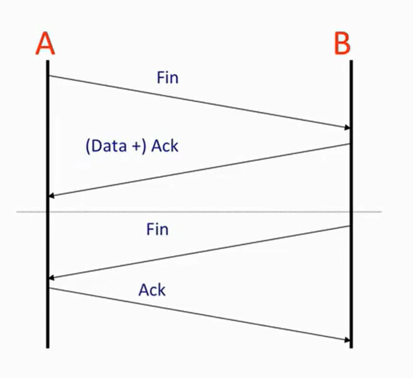

- 主机A可通过发送`FIN`消息关闭连接，主机B确认A无数据可发并停止-接收A的新数据。这关闭了A到B的数据流  
- 但B仍可能有数据要发，因此B发回给A的带`ACK`的消息也可能携带新数据。数据发完后，B会发送一个`FIN`给A  
- 主机A回复一个ACK，确认连接已经关闭

此时双向传输都完成了，连接彻底关闭，状态也可以安全移除

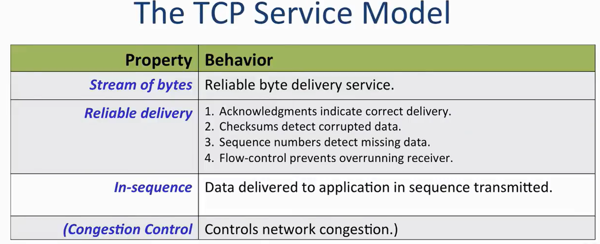

TCP为应用层提供了可靠字节流服务、可靠的通信，并且控制正确的顺序
>TCP保证通信可靠的四种机制：  
>1. TCP层收到数据后，会向发送端回复一个确认，告诉对方数据已经正确到达了
>2. “校验和”用来检测数据是否损坏
>3. 序列号用来检测数据是否丢失
>4. 流量控制

TCP通过控制拥塞，为整个网络提供服务（力求让所有连接平等地分享网络容量）

### TCP段头的结构
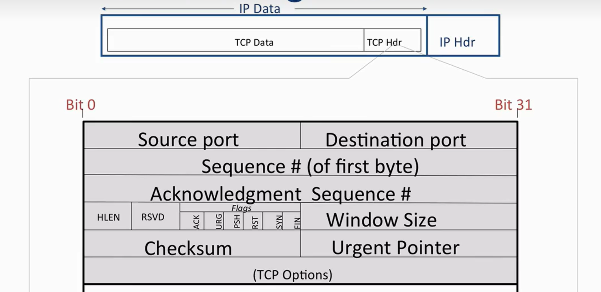
- 源端口：告诉对方TCP层该用哪个端口把数据回传
- 目的端口：告诉TCP层这些字节应该交给对端的哪个程序
- 序列号：标记TCP数据段里第一个字节在整个字节流中的位置
- 确认号：告诉对方我们期望收到的下一个字节是多少（意味着确认号之前的所有字节都已经收到）
>_e.g. 已经确认收到字节序列号为1001、1002、1003、1004  
>则ACK=1005_

>每段数据的双向传输都带有序列号.TCP正是利用反向数据来捎带确认信息
- 头部长度字段：指示TCP头部的长度（指示包含多少选项字段，通常无）
- 标志位：连接控制信号
- 窗口容量：接收方告诉发送方自己还有多少空间（用于流量控制）
- 16位校验和：覆盖整个头部和数据，帮助接收方检测损坏
- TCP选项字段：可选。承载TCP标准制定后新增的额外头部字段

### TCP连接的唯一确定：
TCP连接通常使用四元组进行标识：
$$
\boxed{(\text{源 IP},\text{源端口},\text{目的 IP},\text{目的端口})}
$$
但仍然有连接混淆的风险

主机A使用个简单方法来降低这种概率：每新建一个连接就把源端口号加一（端口字段位16位，因此经过64K个新链接才会回绕）  
但如果主机A突然向主机B发起大量新连接还是存在极轻微的回绕风险

为了降低混淆的可能性，TCP连接会使用一个随机生成的初始序列号（ISN，Initial Sequence Number）来标识字节流中的字节  

主机A向B发起连接时会在发送给B的数据中携带自己将使用的初始序列号  
B在回复并发起连接时也会提供从B到A数据流的初始序列号
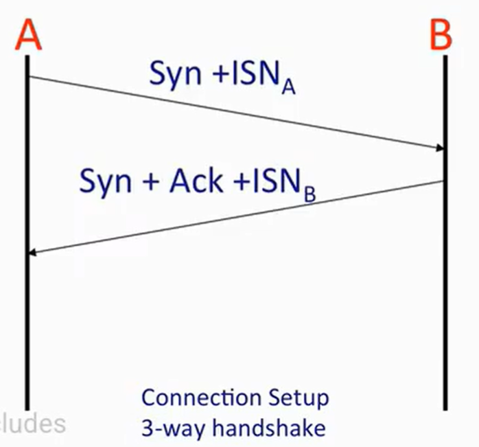
______
## UDP服务模型：
UDP适用于不需要TCP可靠交付的应用（应用自己处理重传或不需要可靠传输）

### UDP头部结构：
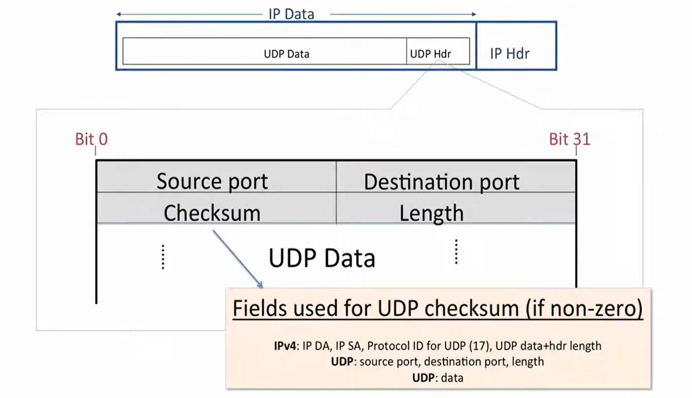
- 校验和：在使用IPv4时，UDP的校验和是可选的（若送方未加校验和，则该字段全为0）
>校验和的计算涵盖了IP源地址、目的地址和协议ID  
>这是为了让UDP层能识别发网错误

### UDP服务的特性：
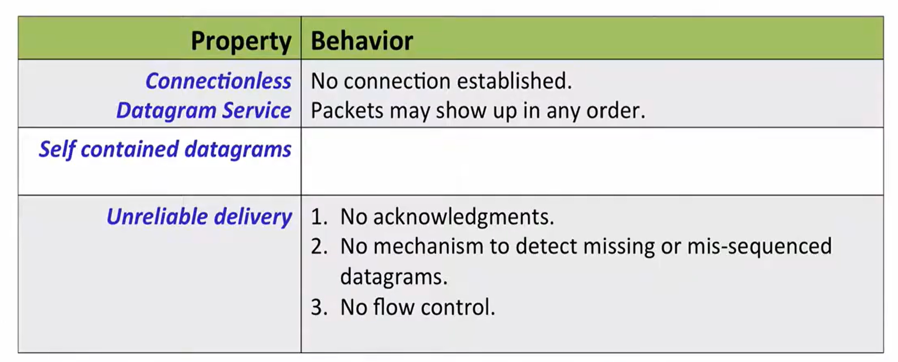
1. 提供无连接的数据报服务，无需建立连接（数据包有可能乱序到达）
2. 不可靠。不会发送确认；不具备检测数据报丢失或乱序的机制；没有流量控制

优点：简单，轻量化